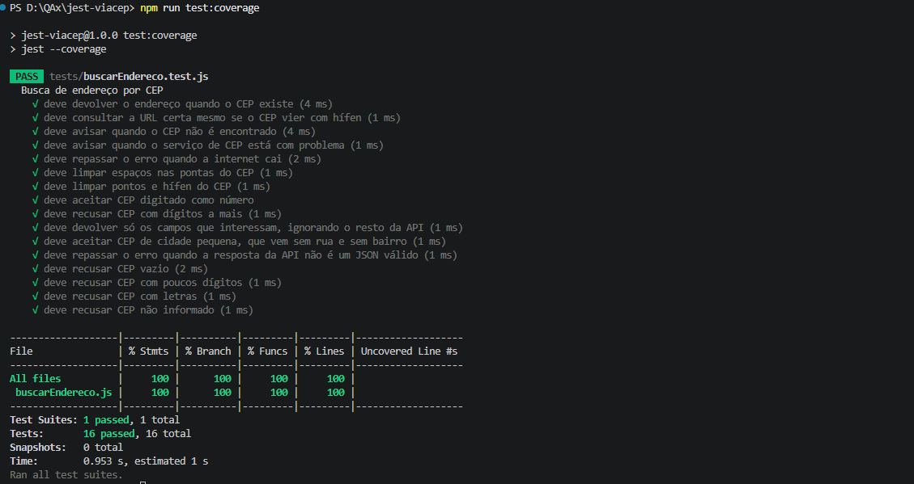

# Jest ViaCEP

Função que busca endereço pelo CEP usando a API pública do [ViaCEP](https://viacep.com.br), com testes unitários em Jest que **não dependem de internet** (o `fetch` é mockado).

## Cobertura de testes



## Como rodar

Precisa de Node 18 ou superior.

```bash
npm install
npm start              # busca o CEP 01001-000 na API real
npm start -- 86200000  # busca outro CEP
npm test               # roda os testes
npm run test:coverage  # roda os testes com cobertura
```

## O que é testado

- Endereço devolvido quando o CEP existe
- URL correta chamada, com CEP limpo (sem hífen, ponto ou espaços) e também quando digitado como número
- CEP não encontrado
- Serviço de CEP com problema
- Falha de rede e resposta com JSON inválido
- CEPs inválidos (vazio, poucos dígitos, dígitos a mais, letras, não informado), sem chamar a API
- Função devolve só os campos necessários, ignorando o resto da resposta da API
- CEPs de cidades pequenas, que vêm sem rua e sem bairro

## Estratégia de testes

O `fetch` é substituído por um mock (`jest.fn()`), então os testes são rápidos, não dependem da API estar no ar e conseguem simular situações difíceis de reproduzir de verdade (internet caindo, resposta quebrada).

## O que aprendi

- Mockar dependências externas com `mockResolvedValue` e `mockRejectedValue`
- Testar código assíncrono com `rejects.toThrow`
- Usar `test.each` para cobrir vários cenários sem repetir código
- Pensar em casos de borda além do caminho feliz